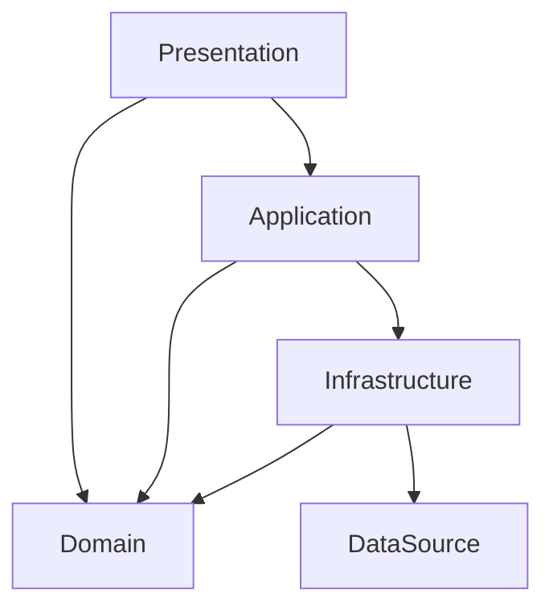

# アーキテクチャガイド

Dareda (iOS / SwiftUI) のコードを追加・変更するときに従うルール。

## 前提

- 対象: iOS 27.0 以上、Swift 6 (Strict Concurrency, Default Actor Isolation = `MainActor`, Approachable Concurrency)、Xcode は `.xcode-version` に固定
- UI: SwiftUI + Observation (`@Observable`)
- DI: [swift-dependencies](https://github.com/pointfreeco/swift-dependencies)
- ローカル DB: [SQLiteData](https://github.com/pointfreeco/sqlite-data)
- テスト: XCUITest による UI テストのみ (例外として #Preview のスナップショット撮影のみ [Prefire](https://github.com/BarredEwe/Prefire) で行う)

## 基本方針

1. **全ての依存を swift-dependencies で DI 可能にする。** 具象型を直接生成・参照せず、`@Dependency` 経由で取得する。
2. **状態は ViewModel だけが持つ。** Presentation 以外のレイヤはステートレスに保つ。
3. **Presenter は作らない。** UseCase / Service が値 (Domain Entity や ServiceModel) を直接返し、ViewModel がそれを表示用に保持する。
4. **ローディング状態・エラー状態は本当に必要なときだけ持つ。** 一瞬で終わる処理や、失敗してもユーザーにできることがない処理に対してまで状態を用意しない。
5. **テストは古典学派。** 可能な限り本物の実装を使い、テストダブルに差し替えるのは DataSource レイヤのみ。

## ディレクトリ構成

```
App/
├── Dareda.xcodeproj
├── Dareda/
│   ├── main.swift                       // エントリポイント。依存の初期設定と UI テスト用の差し替えを行う
│   ├── Presentation/
│   │   ├── DaredaApp.swift              // App 本体。ルート Screen を表示する
│   │   ├── UI/
│   │   │   ├── <Screen Name>Screen.swift
│   │   │   └── <Content Name>Content.swift
│   │   ├── Component/
│   │   │   └── <Component Name>.swift
│   │   └── ViewModel/
│   │       └── <Screen Name>ViewModel.swift
│   ├── Application/
│   │   ├── UseCase/
│   │   │   └── <UseCase Name>UseCase.swift
│   │   ├── Service/
│   │   │   └── <Service Name>Service.swift
│   │   └── ServiceModel/
│   │       └── <Service Name>ServiceModel.swift
│   ├── Domain/
│   │   └── Entity/
│   │       └── <Entity Name>.swift
│   ├── Infrastructure/
│   │   ├── Repository/
│   │   │   └── <Entity Name>Repository.swift
│   │   └── Gateway/
│   │       └── <Gateway Name>Gateway.swift
│   └── DataSource/
│       ├── UserDefaultsClient/
│       │   └── UserDefaultsClient.swift
│       ├── SQLiteDataClient/
│       │   ├── SQLiteDataClient.swift
│       │   └── Migrations.swift
│       └── <API Name>APIClient/
│           └── <API Name>APIClient.swift
└── DaredaUITests/
    └── <Screen Name>ScreenTests.swift
```

- Presentation は機能単位のディレクトリを作らず、`UI` / `Component` / `ViewModel` に直接置く。
- 空のディレクトリは作らない。必要になった時点で作る。

## レイヤ構成



| レイヤ | 責務 | 属するもの | 依存してよいもの |
| --- | --- | --- | --- |
| [Presentation](#presentation) | 画面の表示とユーザー操作の受付、画面状態の保持 | App, Screen, Content, Component, ViewModel | Application, Domain |
| [Application](#application) | ユースケースの実行、Infrastructure の協調 | UseCase, Service, ServiceModel | Domain, Infrastructure |
| [Domain](#domain) | ドメインモデルとそのルールの表現 | Entity | なし |
| [Infrastructure](#infrastructure) | Domain モデルの永続化・外部連携、生データとの変換 | Repository, Gateway | Domain, DataSource |
| [DataSource](#datasource) | I/O の薄いラッパ。テストダブルとの差し替え単位 | 各種 Client | なし |

全レイヤ共通のルール:

- 矢印の向きにだけ依存する。下位レイヤから上位レイヤを参照しない。レイヤを飛ばして参照しない (Presentation → Infrastructure など)。
- 各レイヤの型は他レイヤから `@Dependency` 経由で使う ([DI](#di-swift-dependencies) を参照)。
- エラーは握りつぶさず `throws` で上に返す。どう扱うかは ViewModel で決める。

---

## Presentation

### 責務

- 画面を表示し、ユーザー操作を受け付ける。
- 画面の状態 (表示データ、入力値、遷移、必要な場合のみローディング・エラー) を保持する。アプリ内で状態を持つのはこのレイヤだけ。
- Application を呼び出し、返ってきた値をそのまま状態として保持する。

### 属するもの

| 種類 | 配置 | 役割 | 状態 |
| --- | --- | --- | --- |
| App | `Presentation/DaredaApp.swift` | `App` 本体。ルート Screen を表示する | 持たない |
| `<Screen Name>Screen` | `UI/` | ViewModel を保持し、その値と `send` を Content に渡す | ViewModel のみ (`@State`) |
| `<Content Name>Content` | `UI/` | 渡された値から View を決定する | 持たない |
| `<Component Name>` | `Component/` | 複数の Content で再利用する部品 | 持たない |
| `<Screen Name>ViewModel` | `ViewModel/` | 画面の状態、`enum Action`、`send(_:)` を持つ | 持つ |

### ルール

- **ViewModel**
  - `@Observable` の `final class` にする。Default Actor Isolation が `MainActor` なので `@MainActor` は書かない。
  - UI 操作はすべて `enum Action` で表し、View からは `send(_:)` だけを呼ぶ。Action 名は「何が起きたか」で命名する (`saveButtonTapped`, `onAppear`)。「何をするか」(`save`) にしない。
  - 状態は **struct にまとめず**、プロパティとして個別に並べる。外部から書き換えられないよう `private(set)` にする。
  - 画面遷移の状態 (シート表示、`NavigationPath` など) も ViewModel のプロパティとして持つ。
  - 依存は `@ObservationIgnored @Dependency` で取得する。呼んでよいのは UseCase / Service のみ。
- **Screen**
  - ViewModel を `@State` で保持し、Content に値と `send` を渡すだけにする。レイアウトは書かない。
- **Content**
  - ViewModel を参照しない。View の決定に必要な値と `send: (<Screen Name>ViewModel.Action) -> Void` だけを受け取る。
  - `@State` を持たない。ただしフォーカスやアニメーションなど、ViewModel に持たせる意味のない見た目だけの状態は例外とする。
- **Component**
  - Action に依存しない。必要ならクロージャ (`onTap: () -> Void` など) を受け取る。
- `#Preview` は Content と Component に書く。Screen は依存解決が必要なため書かない。
- UI テストで操作・検証する要素には `accessibilityIdentifier` を `<画面>.<要素>` の形式で付ける。

### 例

```swift
import Dependencies
import Observation

@Observable
final class ProfileViewModel {
    enum Action {
        case onAppear
        case saveButtonTapped
        case nameChanged(String)
    }

    private(set) var name = ""
    private(set) var isSaving = false

    @ObservationIgnored
    @Dependency(\.fetchProfileUseCase) private var fetchProfileUseCase
    @ObservationIgnored
    @Dependency(\.saveProfileUseCase) private var saveProfileUseCase

    func send(_ action: Action) {
        switch action {
        case .onAppear:
            Task { await fetch() }
        case .saveButtonTapped:
            Task { await save() }
        case let .nameChanged(name):
            self.name = name
        }
    }
}
```

```swift
struct ProfileScreen: View {
    @State private var viewModel = ProfileViewModel()

    var body: some View {
        ProfileContent(
            name: viewModel.name,
            isSaving: viewModel.isSaving,
            send: viewModel.send
        )
        .onAppear { viewModel.send(.onAppear) }
    }
}

struct ProfileContent: View {
    let name: String
    let isSaving: Bool
    let send: (ProfileViewModel.Action) -> Void

    var body: some View {
        Form {
            TextField(
                "名前",
                text: Binding(get: { name }, set: { send(.nameChanged($0)) })
            )
            .accessibilityIdentifier("profile.nameTextField")
            Button("保存") { send(.saveButtonTapped) }
                .disabled(isSaving)
                .accessibilityIdentifier("profile.saveButton")
        }
    }
}

#Preview {
    ProfileContent(name: "Dareda", isSaving: false, send: { _ in })
}
```

---

## Application

### 責務

- ユーザー操作に対応する処理 (ユースケース) を実行する。
- 複数の Repository / Gateway を組み合わせ、処理の手順を決める。
- 結果を Domain Entity または ServiceModel として ViewModel に返す。表示用の整形 (Presenter) はしない。
- 状態を持たない。

### 属するもの

| 種類 | 配置 | 役割 |
| --- | --- | --- |
| `<UseCase Name>UseCase` | `Application/UseCase/` | 1 つのユーザー操作に対応する処理 (例: `SignInUseCase`, `FetchProfileUseCase`)。原則として公開メソッドは 1 つ |
| `<Service Name>Service` | `Application/Service/` | 複数の ViewModel / UseCase から使われる、関連するドメイン操作の集まり (例: `LocationService`) |
| `<Service Name>ServiceModel` | `Application/ServiceModel/` | Service が返す値のうち、Domain Entity では表せない複合・加工済みの値 |

### ルール

- UseCase と Service で迷ったら UseCase にする。
- UseCase / Service は [DI](#di-swift-dependencies) の形 (インターフェース + `private struct <型名>Impl`) で定義する。
- UseCase から別の UseCase を呼ばない。共通化したい処理は Service に切り出す。
- ServiceModel は Domain Entity と同じく `nonisolated struct` + `Sendable` + `Equatable` にする。
- DataSource を直接呼ばない。必ず Repository / Gateway を経由する。

### ログ

- Application の UseCase / Service の実装で `import Logging` し、swift-log の `Logger` を直接使う。ログ用途の Logger は DI の例外とし、ラッパの Service / Gateway / Client は作らない。
- Logger の label は `Dareda.<型名>` とする。出力先と最低レベルは `main.swift` で設定する (標準エラー出力、Debug は debug 以上、Release は info 以上)。
- 主要処理の開始・完了は `info`、想定内の拒否や追加入力が必要な結果は `notice`、回復可能な後処理の失敗は `warning`、処理失敗は `error`、キャッシュ利用やキャンセルは `debug` にする。
- エラーはログ後も呼び出し元へ返す。ログには処理名・件数・エラー型などの診断情報だけを含め、氏名・会話本文・音声・ベクトル・ファイルパス・エラーの説明文を含めない。
- 実機検証用の MetricsGateway / MetricsLogClient による計測と signpost は引き続き利用する。

---

## Domain

### 責務

- アプリが扱う概念 (ドメインモデル) と、それ自体が守るべきルールを表現する。
- 他のどのレイヤにも、外部ライブラリにも依存しない。

### 属するもの

| 種類 | 配置 | 役割 |
| --- | --- | --- |
| `<Entity Name>` | `Domain/Entity/` | ドメインモデル |

### ルール

- `nonisolated struct` + `Sendable` + `Equatable` にする。必要に応じて `Identifiable` / `Codable` を付ける。
- 持ってよいロジックは、そのモデル自体のルール (バリデーション、算出プロパティなど) に限る。I/O は持たない。
- import してよいのは Foundation のみ。SQLiteData の `@Table` や API のレスポンス形式をここに持ち込まない。

---

## Infrastructure

### 責務

- Domain モデルを永続化・取得する (Repository)。
- 外部 API・外部サービス・OS 機能と連携する (Gateway)。
- DataSource が扱う生データ (`@Table` 型、`Data`、`Any` など) と Domain モデルの相互変換を Repository / Gateway で行う。生データをこのレイヤより上に漏らさない。
- DTO (変換のためだけの中間型) は定義しない。生データから直接 Domain モデルを組み立てる。ただし SQLiteData の `@Table` 型はテーブル定義に必要なため例外とする。
- 状態を持たない。

### 属するもの

| 種類 | 配置 | 役割 |
| --- | --- | --- |
| `<Entity Name>Repository` | `Infrastructure/Repository/` | Domain モデルのローカル永続化。メソッドは `get` / `set` (必要なら `delete`) を基本にする |
| `<Gateway Name>Gateway` | `Infrastructure/Gateway/` | 外部 API・外部サービス (位置情報、通知など OS 機能を含む) の利用 |

### ルール

- Repository / Gateway は [DI](#di-swift-dependencies) の形で定義する。
- Repository はローカル永続化だけを扱う。ネットワーク越しの取得は Gateway にする。
- 変更の監視が必要な場合は、Repository が `AsyncStream` で Domain Entity を返す。

---

## DataSource

### 責務

- UserDefaults / SQLite / HTTP などの I/O を薄くラップする。
- UI テストでテストダブルに差し替える単位になる。

### 属するもの

| 種類 | 配置 | 役割 |
| --- | --- | --- |
| `UserDefaultsClient` | `DataSource/UserDefaultsClient/` | UserDefaults への値 (`Any`) の読み書き |
| `SQLiteDataClient` | `DataSource/SQLiteDataClient/` | SQLiteData によるテーブル定義 (`@Table`)、マイグレーション、クエリ実行 |
| `<API Name>APIClient` | `DataSource/<API Name>APIClient/` | 外部 API へのリクエスト送信。レスポンスは生データ (`Data` など) のまま返す |

### ルール

- ロジックや Domain モデルへの変換を持たない。変換は Repository / Gateway で行う。
- DTO を定義しない (`@Table` 型のみ例外)。
- [DI](#di-swift-dependencies) の形で定義し、`liveValue` に加えて `testValue` / `previewValue` とテストダブル用のファクトリ (`inMemory()` など) を用意する。
- テストダブルはクライアントのファイル内、または同じディレクトリの `<Client Name>+Test.swift` に置く。
- 差し替えやすい粒度を保つ。1 つの Client に複数の I/O 先を混ぜない。

### SQLiteData

- `@Table` を付けたテーブル定義型は `SQLiteDataClient/` に置き、Domain Entity とは分ける。
- データベースは `main.swift` の `prepareDependencies` で `$0.defaultDatabase` に設定し、SQLiteDataClient は `@Dependency(\.defaultDatabase)` 経由で使う。
- `@FetchAll` / `@FetchOne` / `@Fetch` は使わない。View や ViewModel が DB を直接監視すると、状態の持ち主とレイヤの依存方向が崩れるため。
- UI テストではインメモリのデータベースを使う。

---

## DI (swift-dependencies)

Presentation 以外の各型は、`@DependencyClient` を付けたクロージャの struct (インターフェース) と、`private struct <型名>Impl` (実装) に分けて定義する。

- インターフェースはクロージャのプロパティだけを持つ。
- 実装は `<型名>Impl` に書く。依存は `Impl` のプロパティとして `@Dependency` で取得し、処理は `Impl` のメソッドとして実装する。
- `liveValue` では `Impl` を生成し、`Impl` のメソッド参照 (`impl.get` など) をそのまま渡す。クロージャで包んだり、処理を書いたりしない。

```swift
import Dependencies
import DependenciesMacros

@DependencyClient
nonisolated struct ProfileRepository: Sendable {
    var get: @Sendable () async throws -> Profile?
    var set: @Sendable (_ profile: Profile) async throws -> Void
}

nonisolated extension ProfileRepository: DependencyKey {
    static let liveValue: ProfileRepository = {
        let impl = ProfileRepositoryImpl()
        return ProfileRepository(
            get: impl.get,
            set: impl.set
        )
    }()
}

nonisolated extension DependencyValues {
    var profileRepository: ProfileRepository {
        get { self[ProfileRepository.self] }
        set { self[ProfileRepository.self] = newValue }
    }
}

private nonisolated struct ProfileRepositoryImpl: Sendable {
    @Dependency(\.userDefaultsClient) private var userDefaultsClient

    func get() async throws -> Profile? {
        // userDefaultsClient から読み出して Profile に変換する
    }

    func set(_ profile: Profile) async throws {
        // Profile を変換して userDefaultsClient に書き込む
    }
}
```

DataSource も同じ形にする。外部の API (`UserDefaults` など) は `Impl` の中でだけ触る。

```swift
@DependencyClient
nonisolated struct UserDefaultsClient: Sendable {
    var value: @Sendable (_ forKey: String) -> Any?
    var setValue: @Sendable (_ value: Any?, _ forKey: String) -> Void
}

nonisolated extension UserDefaultsClient: DependencyKey {
    static let liveValue: UserDefaultsClient = {
        let impl = UserDefaultsClientImpl()
        return UserDefaultsClient(
            value: impl.value(forKey:),
            setValue: impl.setValue(_:forKey:)
        )
    }()
}

private nonisolated struct UserDefaultsClientImpl: Sendable {
    func value(forKey key: String) -> Any? {
        UserDefaults.standard.object(forKey: key)
    }

    func setValue(_ value: Any?, forKey key: String) {
        UserDefaults.standard.set(value, forKey: key)
    }
}
```

- インターフェース、`DependencyKey` 準拠、`DependencyValues` 拡張、`Impl` は同じファイルに、この順で置く。
- `Impl` は `private` にし、ファイルの外から参照しない。
- `liveValue` は全レイヤで定義する。`testValue` / `previewValue` は **DataSource のみ** 定義する (上位レイヤはテストでも本物を使うため)。
- 型は `Sendable` にする。`Impl` も可変状態を持たない。
- `DependencyValues` のキー名は型名の lowerCamelCase (`\.profileRepository`)。

## Concurrency

アプリターゲットは Default Actor Isolation が `MainActor` なので、何も書かなければ全ての型が `@MainActor` になる。

- **Presentation**: 何も付けない (`MainActor` のまま)。`@MainActor` も明示しない。
- **Application / Domain / Infrastructure / DataSource**: 型と extension (`DependencyKey` / `DependencyValues` を含む) に `nonisolated` を付けて `MainActor` から外す。
  - `MainActor` のままだと `DependencyKey` の `liveValue` などの要件を満たせず、Domain Entity も UI 以外から扱いにくくなるため。
- Approachable Concurrency (`NonisolatedNonsendingByDefault`) が有効なので、`nonisolated` な `async` 関数は呼び出し元のアクターで実行される。重い処理をメインスレッドから外したい場合だけ `@concurrent` を付ける。

## テスト

- **ユニットテストは書かない。UI テスト (`DaredaUITests`) のみ実装する。** ただし [スナップショットテスト](#スナップショットテスト) は例外とする。
- 画面単位で `<Screen Name>ScreenTests.swift` を作る。
- 古典学派に従い、Presentation 〜 Infrastructure は本物の実装を動かす。テストダブルに差し替えるのは DataSource のみ。
- UI テストはアプリと別プロセスで動くため、`launchEnvironment` でシナリオを渡し、アプリ側の `main.swift` で DataSource を差し替える。

```swift
// App/Dareda/main.swift
import Dependencies
import SwiftUI

let scenario = ProcessInfo.processInfo.environment["UI_TEST_SCENARIO"]

prepareDependencies {
    if let scenario {
        $0.defaultDatabase = try! appDatabase(inMemory: true)
        $0.userDefaultsClient = .inMemory()
        // scenario に応じて DataSource の振る舞いや初期データを切り替える
    } else {
        $0.defaultDatabase = try! appDatabase()
    }
}

DaredaApp.main()
```

```swift
// App/DaredaUITests/ProfileScreenTests.swift
final class ProfileScreenTests: XCTestCase {
    override func setUp() {
        continueAfterFailure = false
    }

    @MainActor
    func test名前を保存すると再起動後も表示される() {
        let app = XCUIApplication()
        app.launchEnvironment["UI_TEST_SCENARIO"] = "default"
        app.launch()
        // ...
    }
}
```

- テストダブルはアプリターゲットに含まれるが、`UI_TEST_SCENARIO` 指定時以外は使わない。
- 要素の検索は `accessibilityIdentifier` で行い、表示文言に依存しない。
- 非同期な表示の待機は `waitForExistence(timeout:)` を使い、`sleep` は使わない。

### スナップショットテスト

UI テストのルールの例外として、`DaredaSnapshotTests` で #Preview の画像を撮り、reg-suit で VRT (Visual Regression Test) を行う。

- テストコードは手で書かない。Prefire が `App/DaredaSnapshotTests/PreviewTests.stencil` から #Preview ごとのテストを生成する。
- 生成されるテストはアサーションせず、画像を `XCTAttachment` として残すだけにする。期待値との比較は CI の reg-suit で行い、期待値画像はリポジトリにコミットしない。
- 撮影対象を増やしたいときは、Content / Component に #Preview を追加する。
- #Preview では `.now` や `UUID()` の表示など実行ごとに変わる値を表示しない。固定の日時 (`Date(timeIntervalSince1970:)`) などを使い、差分が出ないようにする。
