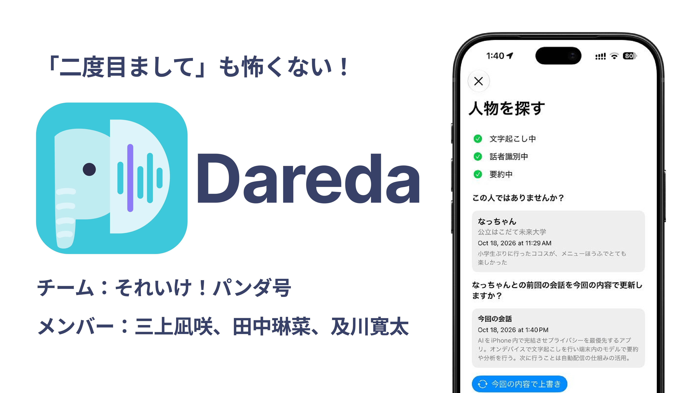
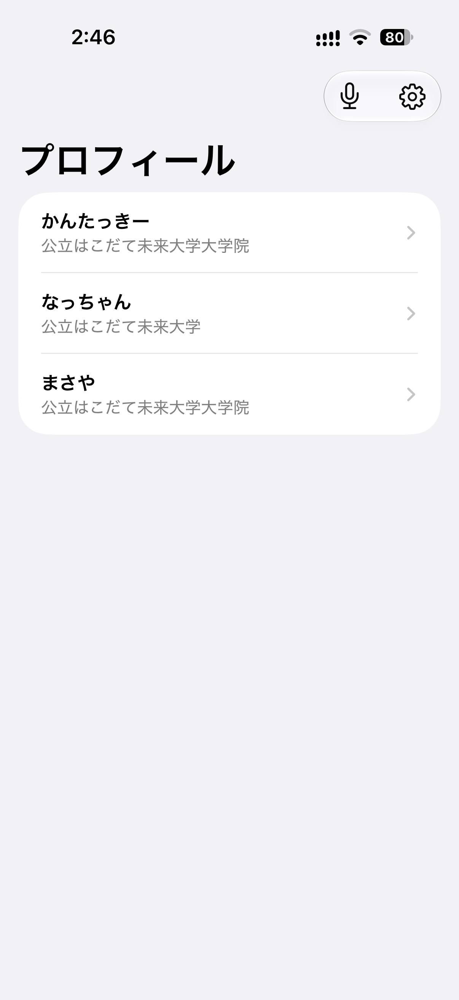
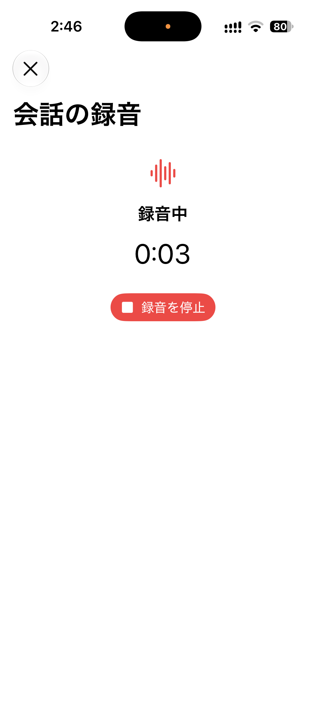
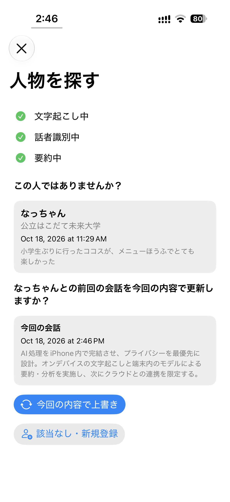
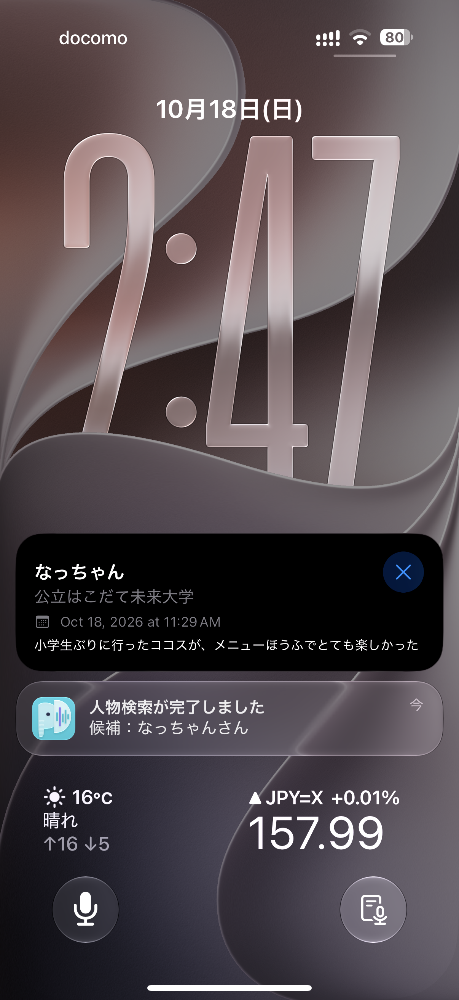
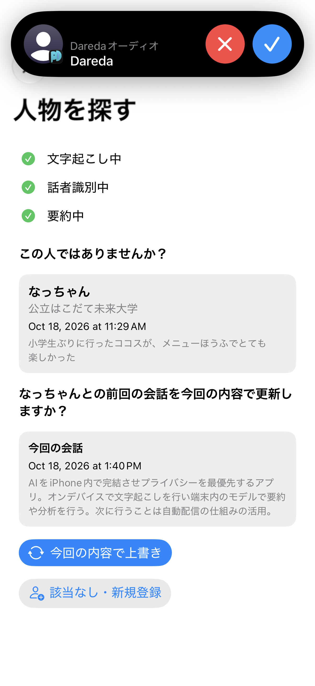
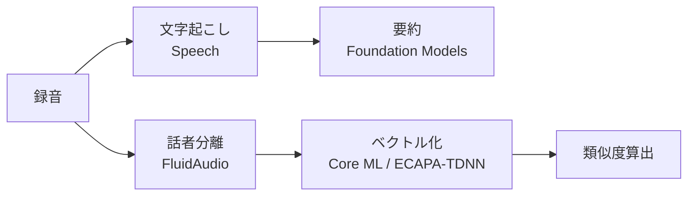

# Dareda

[プロモーション動画](https://drive.google.com/file/d/1GNp6YJ_4w0l8VMu3yBd_hzAsZILUIQUd/view?usp=sharing)

## 製品概要

### 背景(製品開発のきっかけ、課題等）

「二度目まして」のとき、「この人、誰だ…」と焦った経験はないだろうか。
顔は覚えているのに、名前や前回話した内容が出てこない。聞き直すのも失礼な気がして、気まずいまま会話が終わってしまう。そんなとき、「隣でそっと教えてくれる人がいたらいいのに」と思ったのがきっかけである。

名刺管理アプリや顔認識など、使えそうなものはあるが、再会したその場ではどれも使いにくい。

| 手段                          | 使いにくい点                                                       |
| ----------------------------- | ------------------------------------------------------------------ |
| 名刺・連絡先のメモ            | 相手の名前が分からないと検索できない。相手の前で見返しにくい       |
| 顔認識                        | 相手にカメラを向ける必要がある。顔写真を集めること自体に抵抗がある |
| AI 議事録 (Notta・Plaud など) | 会話の記録や要約はできるが、目の前の相手が誰かは教えてくれない     |

一方で、会話をしていれば相手の声は必ず聞こえている。そこで、声を手がかりに相手を特定することにした。

### 製品説明（具体的な製品の説明）

1対1の会話から相手の声の特徴と会話の要約を記録し、再会時に声で相手を特定して教えてくれる iOS アプリ。

1. **自分の声を登録** : 最初に例文を読み上げて、自分の声を登録する
2. **初対面で記録** : 会話を録音すると、自分と相手の声を聞き分ける。相手の声の特徴(ベクトル)と会話の要約を、名前・所属・日時・場所と一緒に保存する
3. **再会時に特定** : 会話を録音すると保存済みの声と照合し、最も声が近い人の名前・所属・前回の話の要約を知らせる

#### 再会したときの流れ

1. 会話が始まったら、Apple Watch かコントロールセンターから録音を始める (アプリは開かない)
2. 少し話したら録音を止める。処理はバックグラウンドで続くので、iPhone はポケットに入れたままでよい
3. 結果が出ると電話がかかってくる。耳に当てると「この方は、〇〇さんではありませんか？△△所属です。前回は、□□で、次のような話をしました。」と読み上げる
4. 電話に出られない場面では、Apple Watch の通知で確認する

#### 画面イメージ

| プロフィール一覧                                                       | 会話の録音                                                       | 人物を探す (処理中)                                                       | 人物を探す (結果)                                                       | 通知                                                                                    | 着信                                                                  |
| ---------------------------------------------------------------------- | ---------------------------------------------------------------- | ------------------------------------------------------------------------- | ----------------------------------------------------------------------- | --------------------------------------------------------------------------------------- | --------------------------------------------------------------------- |
|  |  |  |  |  |  |

### 特長

#### 1. 相手の前でも不自然にならない知らせ方

相手の前でスマートフォンを操作すると、名前を忘れていることが伝わってしまう。Dareda は画面を見なくても結果が分かるようにした。

中心にしたのは電話である。会話の途中で電話がかかってきて耳に当てるのはよくあることなので、相手に不審に思われない。読み上げは耳元でだけ聞こえるため、AirPods やサードパーティー製の Bluetooth イヤホンがなくても iPhone を耳に当てれば周りに聞かれずに済む。着信は通知より気づきやすく、iPhone をポケットに入れたままでも結果が出たことが分かる。

| 方法           | デバイス            | 使う場面                                                     |
| -------------- | ------------------- | ------------------------------------------------------------ |
| 着信と読み上げ | iPhone・AirPods やサードパーティー製の Bluetooth イヤホン | 電話に出るふりをして耳元で聞く。着信画面に相手の名前は出ない |
| 通知           | iPhone・Apple Watch | 手元をちらっと見て確認する                                   |
| Live Activity  | iPhone・Apple Watch | 録音から判定までの進み具合をロック画面や手元で見る           |

録音は、Apple Watch・コントロールセンター・ショートカットから、アプリを開かずに始められる。Apple Watch のマイクでも録音できる。

#### 2. 録音から識別まで一貫してオンデバイスで完結

話者分離・文字起こし・声の照合・要約・着信の読み上げまで、すべて iPhone の中で処理する。Apple Watch で録った音声も、サーバーを通さず iPhone に直接送る。

要約だけは、会話が長くて端末内のモデルで処理しきれない場合に、ユーザーの同意を得て Apple の Private Cloud Compute (PCC) を使う。送るのは文字起こしと指示文だけで、音声や声の特徴、プロフィールは送らない。PCC に送ったデータは処理が終わると保持されず、Apple も中身を見ることができない。モデルの学習にも使われない ([Apple の説明](https://security.apple.com/blog/private-cloud-compute/))。同意しない場合は、要約も端末内で行う。

#### 3. 録音を残さず、サーバーにも送らない

会話の録音には、相手の声も話の内容もそのまま入っている。情報流出が相次ぐ今、こうしたデータを外部に預けるのは不安が大きい。そのため Dareda では、録音を残さず、サーバーにも送らないようにした。

- 録音した音声は、照合や登録が終わった時点で削除する。キャンセルしたときも同じで、アプリが途中で落ちて残ったものは次の起動時に消す。文字起こしや処理途中のベクトルも残さない
- Dareda 用のサーバーはなく、音声や声の特徴を外部に送ることはない
- 端末に保存するのは、相手の声の特徴ベクトル (192 個の数値で、音声としては再生できない) と、ユーザーが確認したプロフィール・要約だけ

### 解決出来ること

- 再会した相手の名前と前回の話題を、相手に気づかれずに思い出せる
- 名刺や連絡先を見返す手間がなくなり、会話そのものに集中できる
- 「前回〇〇の話をしましたよね」と会話を続けられ、人とのつながりを取りこぼさない

想定しているのは、展示会や学会、営業、地域の集まりなどで、一度会った人と時間をおいて再会することが多い人である。名刺交換をしない場面でも、会話をすれば記録が残る。

### 今後の展望

- 前回の要約をもとに、次に会う前に話題の候補を提案する
- 話す速さや声の高さなど、話し方の特徴もプロフィールに残し、思い出す手がかりにする
- 3人以上の会話で、それぞれの相手を特定する
- 照合の精度を上げ、録音を止めてから知らせるまでの時間を縮める

### 注力したこと（こだわり等）

- **アプリを開かずに完結する使い方**
  録音の開始から結果の確認まで、iPhone の画面を見ずに使える。処理は `BGContinuedProcessingTask` でバックグラウンドでも続け、着信と読み上げは CallKit と端末内の音声合成で行っている。
- **自分の声と相手の声の聞き分け**
  録音には自分の声も入る。話者分離のあと、登録した自分の声と照合して自分を除き、残った話者を相手とする。文字起こしは単語ごとに話者を割り当て、誰の発言かがずれないようにした。
- **実機で録り直さずに精度を詰める仕組み**
  アプリと同じ処理を Mac で動かす評価用 CLI を作った。同じ録音のまま設定を変えて、DER (話者分離の誤り率) と本人識別の正否を比べられる。
- **プライバシー**
  録音は処理が終わったら消し、サーバーも持たない。端末の外で処理するのは、同意を得たときの PCC での要約だけにした。

## 開発技術

### 動作環境

- 対象: Apple Intelligence 対応の iPhone (Apple Watch・AirPods やサードパーティー製の Bluetooth イヤホンは任意)
- 最低 OS: iOS 27.0

### 活用した技術

#### API・データ

- Foundation Models (Apple Intelligence のオンデバイス言語モデル / Private Cloud Compute) による会話の要約
- Speech (SpeechAnalyzer / SpeechTranscriber) によるオンデバイス文字起こし
- FluidAudio の話者分離 (OfflineDiarizer)
- ECAPA-TDNN (SpeechBrain) を Core ML に変換した話者埋め込みモデルによる声の照合
- MapKit (MKLocalSearch) による場所の検索

#### フレームワーク・ライブラリ・モジュール

- SwiftUI / Observation (`@Observable`)
- swift-dependencies (DI) / SQLiteData (ローカル DB)
- Core ML / AVFoundation / CallKit / UserNotifications
- ActivityKit / WidgetKit / App Intents (Live Activity・コントロール・ショートカット)
- WatchConnectivity (iPhone と Apple Watch の同期)
- BackgroundTasks (`BGContinuedProcessingTask`)
- XCUITest / スナップショットテスト (UI テスト・見た目の差分検出)
- Terraform / GitHub Actions / fastlane / Firebase App Distribution (インフラ・CI/CD・配信)

#### デバイス

- iPhone (Apple Intelligence 対応機種)
- Apple Watch (録音・通知・Live Activity)
- AirPods やサードパーティー製の Bluetooth イヤホン (通知・着信への応答)

専用のハードウェアは作らず、多くの人がすでに持っている iPhone・Apple Watch・AirPods やサードパーティー製の Bluetooth イヤホンだけで動くようにした。新しい機器を買ったり身に着けたりする必要がなく、アプリを入れればその日から使える。Apple Watch とイヤホンは任意で、iPhone だけでもすべての機能を使える。

### 独自技術

#### ハッカソンで開発した独自機能・技術

- 声の特徴ベクトルによる人物検索: [`SearchPersonUseCase.swift`](App/Dareda/Application/UseCase/SearchPersonUseCase.swift)
- 自分の声を除いて相手を特定する 2 段階の照合: [`VectorMatchingService.swift`](App/Dareda/Application/Service/VectorMatchingService.swift) / [`ConversationAnalysisService.swift`](App/Dareda/Application/Service/ConversationAnalysisService.swift)
- 話者分離・声の埋め込み: [`FluidAudioClient.swift`](App/Dareda/DataSource/FluidAudioClient/FluidAudioClient.swift)
- ECAPA-TDNN を、特徴量 (fbank) の計算まで含めて 1 つの Core ML モデルに変換するスクリプト: [`Tools/ecapa/convert.py`](Tools/ecapa/convert.py)
- 話者分離と本人識別の設定を比較する評価用 CLI: [`Tools/diarization-eval`](Tools/diarization-eval)
- 着信で相手の情報を読み上げる仕組み: [`VoiceCallGateway.swift`](App/Dareda/Infrastructure/Gateway/VoiceCallGateway.swift)
- 人物検索結果の通知 (iPhone・Apple Watch): [`NotifyPersonSearchResultUseCase.swift`](App/Dareda/Application/UseCase/NotifyPersonSearchResultUseCase.swift)
- Live Activity による録音・処理状況の表示: [`RecordingActivityGateway.swift`](App/Dareda/Infrastructure/Gateway/RecordingActivityGateway.swift)
- Apple Watch での録音と iPhone との同期: [`App/DaredaWatch`](App/DaredaWatch)

#### AI エージェントを活用した開発フロー

要件定義からタスク分割、実装、PR 作成、配布までを AI エージェントと分担し、少人数でも複数のタスクを並列に進められるようにした。

1. **要件定義・仕様の作成**: 人間が考えた「やりたいこと」と思いつくユーザーフローを元に、要求仕様書と開発仕様書を Notion に書き出す。
2. **Issue の作成**: あらかじめ用意した Issue テンプレート ([`task.md`](.github/ISSUE_TEMPLATE/task.md)) の項目 (概要・対応内容・注意点・受け入れ基準・依存するIssue・関連リンク) を満たすように、仕様から GitHub Issue を作成する。タスク間の依存関係も Issue に記述する。
3. **タスクの選定から PR 作成まで**: [`triage-task`](.rulesync/skills/triage-task/SKILL.md) スキルで、依存関係と優先度から着手するタスクを選び、不明点の質問と仕様書・Issue への反映、ワークツリーでの実装、UI テストの追加、PR 作成までを一貫して行う。
4. **並列での進行**: 依存関係が明確で、タスクのステータスは GitHub Projects で都度更新されるため、複数のエージェントで同時に別のタスクを進められる。
5. **成果物の即時確認**: Xcode MCP 経由でシミュレーターで撮影したスクリーンショットを PR に添付させるほか、main にマージされると GitHub Actions ([`distribute.yml`](.github/workflows/distribute.yml)) で Firebase App Distribution にビルドがアップロードされるため、開発者はすぐに実機で成果物を確認できる。
